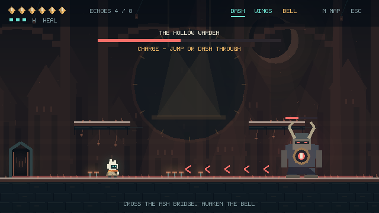

# LUMENFALL：空心钟

一款原创的短篇类银河恶魔城游戏原型，使用 **C++17 + SFML 3.x**，默认固定到 **SFML 3.0.2**。

**当前版本 1.0.1**：修复 Windows 中文用户名或非 ASCII 自定义存档目录可能导致的 `Cannot convert character sequence: Illegal byte sequence` 启动错误。窗口标题中可确认版本号；兼容原有存档。

小布偶「灯芯」在地下钟城醒来。探索相互连接的废墟，找回冲刺和线翼，带着钟心走向守钟者，重新点亮黎明。



## 运行

压缩包包含 `play-windows/Lumenfall.exe`。Windows 10/11 的 64 位系统可先解压整个压缩包，再双击该文件。该文件已交叉编译，尚未在原生 Windows 实玩验证；详细记录见 `docs/TEST_REPORT.md`。

重新编译需要 **Visual Studio 2022** 的“使用 C++ 的桌面开发”工作负载，以及 CMake。工程附带 SFML、FreeType、Ogg、Vorbis、FLAC 的固定版本源码；使用这些源码构建时不需要再下载游戏依赖。

1. 解压到普通本地目录，例如 `D:\Games\Lumenfall`。
2. 打开 **x64 Native Tools Command Prompt for VS 2022**，进入工程目录。
3. 运行 `build_windows.cmd`。脚本会构建、运行逻辑测试，然后启动游戏。

也可手动执行：

```powershell
cmake -S . -B build-vs -G "Visual Studio 17 2022" -A x64
cmake --build build-vs --config Release --parallel
ctest --test-dir build-vs -C Release --output-on-failure
.\build-vs\bin\Release\Lumenfall.exe
```

**VS Code**：安装 C/C++、CMake Tools 扩展，打开本目录，选择安装好的 MSVC x64 工具链，执行 CMake Configure / Build，运行 `Lumenfall` 目标。VS Code 编辑器本身不包含 C++ 编译器。

**已有 SFML 3.x**：使用与编译器、架构一致的 SFML 安装，并设置：

```powershell
cmake -S . -B build-system -DLUMEN_USE_SYSTEM_SFML=ON -DSFML_DIR="D:/SFML/lib/cmake/SFML"
cmake --build build-system --config Release
```

工程使用 SFML 3 的事件可选值、`sf::Keyboard::Key`、向量构造与 `SFML::Graphics` 等接口。SFML 2.x 不适用。

## 操作

| 按键 | 功能 |
|---|---|
| A / D，或方向键左右 | 移动 |
| Space / Z | 跳跃；按住跳得更高，松开提前下落 |
| 再按一次跳跃 | 获得线翼后执行二段跳 |
| J / X | 近战攻击；连续第三击造成双倍伤害 |
| ↑ + J / X | 向上攻击 |
| K / Shift | 获得能力后冲刺；冲刺期间免疫敌人伤害，可击碎青色屏障 |
| 按住 H | 站稳治疗：消耗一格治疗次数，回复 2 点生命 |
| E / W | 进入门、阅读记忆、在灯笼处休息存档 |
| M / Tab | 地图；打开时暂停游戏 |
| Esc / P | 暂停菜单 |
| F | 静音 / 恢复声音 |

悬空薄平台可从下方穿过；落在上面后可继续起跳。冲刺不能免疫尖刺和坠落。

门旁按 **E** 切换区域；不会在屏幕边缘自动换房。死亡或跌入危险地形会返回最近激活的灯笼。收集到的能力、回响与打开的屏障会保留。

## 内容

- **8 个互通区域**：主线探索、能力回访、两条回到枢纽的捷径。
- **3 个关键收集物**：余烬冲刺、线翼二段跳、钟心。
- **8 枚可选回响**：每集齐 3 枚增加 1 点生命上限，初始 5 点，最高 7 点。
- **3 类普通敌人**：巡逻爬行者、飞蛾、远程哨兵；近战可击碎普通弹丸。
- **1 场两阶段 Boss 战**：空心守钟者，具备冲锋、砸地震波、落雷、近身横扫。
- 标题、暂停、地图、操作说明、结局、存档与继续游戏。
- 原创像素角色、分层背景、区域配色、灯光、攻击粒子、镜头震动、程序合成环境音乐及音效。

游戏界面采用内置英文像素字形；本说明、路线及设计文档为中文。美术、字体与声音由代码生成，游戏运行时无需额外资源文件。

## 地图与主线提示

| 区域 | 目的与连接 |
|---|---|
| 苏醒井 / The Waking Well | 学习移动、攻击与存档；前往灯笼枢纽 |
| 灯笼枢纽 / Lantern Crossroads | 中央休息点；水道在右侧，高处门通往花园，最右侧门由钟心开启 |
| 苔藓水道 / Moss Cistern | 获得冲刺，冲破最右侧青色屏障进入档案馆 |
| 静默档案馆 / Hush Archive | 从高台边缘起跳并冲刺越过深沟；高处取得二段跳，右侧捷径返回枢纽 |
| 悬空花园 / Hanging Gardens | 二段跳到达枢纽左上方的门；沿高台前进到铸钟厂 |
| 铸钟厂 / Bell Foundry | 取得钟心，通过右侧升降门返回枢纽 |
| 灰烬长桥 / Bridge of Ash | 通过枢纽最右侧的门进入；Boss 前有恢复灯笼 |
| 钟之心 / Heart of the Bell | 击败守钟者，在场地中央的光点按 E 查看结局 |

攻略和 Boss 招式详解见 [docs/DESIGN_ZH.md](docs/DESIGN_ZH.md)。

## Linux / macOS 构建

Ubuntu / Debian 先安装系统图形依赖：

```bash
sudo apt install build-essential cmake git libx11-dev libxrandr-dev libxcursor-dev libxi-dev libudev-dev libgl1-mesa-dev
cmake -S . -B build-local -DCMAKE_BUILD_TYPE=Release
cmake --build build-local --parallel 4
ctest --test-dir build-local --output-on-failure
./build-local/bin/Lumenfall
```

也可执行 `sh build_linux.sh`。Linux 版本需要可用的 X11 / XWayland 和 OpenGL 环境。macOS 可使用 Xcode Command Line Tools 与 CMake 构建，尚未在 macOS 实机验证。

`-DLUMEN_AUDIO=OFF` 可构建无音频版本；`--no-audio` 可在启动时跳过音频初始化。

## 存档

在灯笼旁按 E 会记录复活点并补满生命、治疗次数。取得能力、回响、破坏屏障、Boss 胜利及正常退出时也会保存已取得的进度；继续游戏的位置始终是最近的灯笼。

| 系统 | 默认位置 |
|---|---|
| Windows | `%LOCALAPPDATA%\Lumenfall\save.dat` |
| Linux | `$XDG_DATA_HOME/lumenfall/save.dat`，或 `~/.local/share/lumenfall/save.dat` |
| macOS | `~/Library/Application Support/Lumenfall/save.dat` |

可通过 `LUMENFALL_SAVE_DIR` 指定目录。写入时保留上一份 `.bak`；若主存档损坏，启动时尝试读取备份。标题菜单选择新游戏需要再次确认覆盖。

## 源码结构

| 文件 | 职责 |
|---|---|
| `src/main.cpp` | SFML 3 窗口、事件、固定时间步、菜单状态与存档调用 |
| `include/Core.hpp` | 与 SFML 解耦的数据结构及游戏状态 |
| `src/Core.cpp` | 移动碰撞、攻击、敌人、能力、Boss 状态机 |
| `src/World.cpp` | 8 个区域的平台、危险区、敌人、门、收集物及灯笼 |
| `src/Renderer.cpp` | 批量三角形渲染、像素字形、角色、背景、地图、UI |
| `src/Audio.cpp` | 程序合成音效和两段循环音乐 |
| `src/Save.cpp` | 存档校验、备份、恢复与跨平台路径 |
| `tests/core_tests.cpp` | 操作、真实输入跳跃路线、战斗、Boss、存档回归测试 |
| `third_party/` | 固定版本的第三方依赖源码及各自许可证 |

改变地图，编辑 `World.cpp` 的 `solids`、`hazards`、`portals`、`items` 等表。坐标向右、向下递增；角色坐标是左上角，门和灯笼坐标是地面锚点。高度不超过 22 的实体作为单向平台处理。

只测试游戏逻辑，不安装 SFML：

```bash
cmake -S . -B build-core -DLUMEN_BUILD_GAME=OFF
cmake --build build-core
ctest --test-dir build-core --output-on-failure
```

截图/检查模式：

```bash
Lumenfall --scene boss --no-audio --frames 2 --capture boss.png
```

`--scene` 支持 `title / hub / garden / boss / map / ending`。场景检查和截图模式不会写入玩家存档。

## 版本和授权

这是可扩展的完整小型可玩原型：采用程序绘制像素画面及合成声音，尚未制作商业游戏级手绘动画、完整配乐、手柄支持或更多章节。

原创代码采用 MIT 许可证。第三方依赖的授权见 `THIRD_PARTY_NOTICES.md` 与 `third_party` 内的许可证。

技术参考：[SFML 3.0 迁移指南](https://www.sfml-dev.org/tutorials/3.0/getting-started/migrate/)、[CMake 工程说明](https://www.sfml-dev.org/tutorials/3.0/getting-started/cmake/)、[3.0.2 API 文档](https://www.sfml-dev.org/documentation/3.0.2/)。探索与能力解锁节奏参考 [Sheepy: A Short Adventure 的官方介绍](https://mrsuicidesheep.itch.io/sheepy)。
