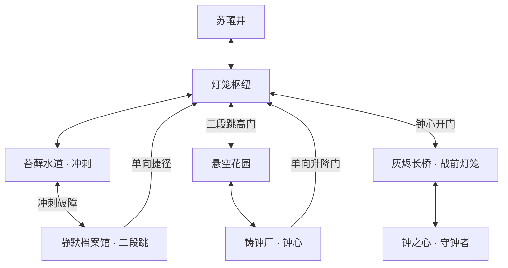

# 地图与战斗设计

## 体验目标

围绕“微小的光唤醒巨大废墟”组织短篇冒险。路线先教基础跳跃，再取得冲刺，借冲刺到达二段跳；回到见过但无法到达的高门，使用新能力进入下一条路线。灯笼枢纽与两条单向捷径让能力回访构成探索闭环。

预计首轮游玩约 15–25 分钟，实际时长取决于探索和战斗熟练程度；该时间是设计目标。

## 拓扑

地图有 8 枚回响。第 3、6 枚各提升 1 点最大生命；最后两枚为可选探索奖励，不影响通关。花园下方的隐藏平台能以二段跳经右侧平台返回主路。

## 操作手感

- 固定 120 Hz 物理更新，渲染独立于物理。
- 约 110 ms 离地宽容时间，约 130 ms 跳跃预输入缓冲。
- 按住跳跃可获得完整高度；松开后增加上升阶段重力。
- 冲刺持续约 180 ms，冷却约 520 ms，一次滞空可冲刺一次；落地刷新空中次数。
- 冲刺结束后速度回到正常水平，防止冲过狭窄平台。
- 按住 H 原地施法约 780 ms，消耗一格次数回复 2 点生命；移动、跳跃或受伤会中断。
- 连续攻击为 1 / 1 / 2 点伤害；每次挥击对同一目标只结算一次。
- 死亡保留探索成果；休息补满 3 次治疗。

## Boss：空心守钟者

钟城最后的守卫是一具胸腔内悬着破碎钟心的铜制自动机。玩家走到场地内侧后，入口封闭；战前灯笼位于上一房间。

42 点生命，生命降至 21 或以下时进入第二阶段。转阶段持续 1.5 秒，清空现有弹幕；此时无法对其造成伤害，也不造成接触伤害。

| 招式 | 预警 | 执行 | 玩家应对 / 反击 |
|---|---|---|---|
| 冲锋 | 头顶读条，地面方向箭头，固定朝向 | 横穿场地，碰撞造成 2 点伤害 | 二段跳越过，或冲刺穿过；撞到边界后僵直 1.3 秒 |
| 钟落 | 读条后起跳，地面显示锁定落点 | 抛物线落地，向两侧发射低位震波 | 离开锁定位置，再跳过震波；落地僵直 1.45 秒 |
| 灰雨 | 读条，随后出现竖直标线和地面红标 | 落雷列短暂生效 | 走出红标区域；可以利用空档治疗，结束后反击 |
| 横扫 | 近身时才选择，红色范围提示 | 面前大范围横扫，造成 2 点伤害 | 退到范围外或冲刺穿过，结束后僵直 1.1 秒 |

第二阶段变化：

- 预警更短，冲锋速度从 370 提高到 485。
- 冲锋结束附加一枚地面震波。
- 钟落增加延迟约 0.46 秒的第二组震波。
- 灰雨由 3 列增加至 5 列。
- 保留可读的预警和完整反击时间；僵直期间接触 Boss 不受伤。

基础循环为冲锋 → 钟落 → 灰雨 → 近距离横扫 / 远距离冲锋。第二阶段沿用已学会的招式，再增加节奏变化。

击败后所有残留攻击消失，封锁解除。走到场地中央的光点，按 E 进入结局。也可以先返回探索未取得的回响；再次继续游戏后，Boss 的击败状态会保留。

## 视觉与声音

逻辑画布 640 × 360，默认窗口 1280 × 720。窗口缩放保持比例，留黑边。内置 5 × 7 像素字形使用整数缩放。

区域以青蓝、苔绿、档案紫、铜金和钟室暗红区分；多层视差建筑、垂落藤蔓、书架、传动轮、光束和粉尘构成背景。战斗判定边缘和危险地形保持明亮。

音乐由短循环的泛音、低频铺底和琶音合成；Boss 使用更密集节奏。没有外部音乐或字体加载步骤。纹理和角色也由 C++ 图元生成，可在 `Renderer.cpp` 中替换为精灵图动画。
